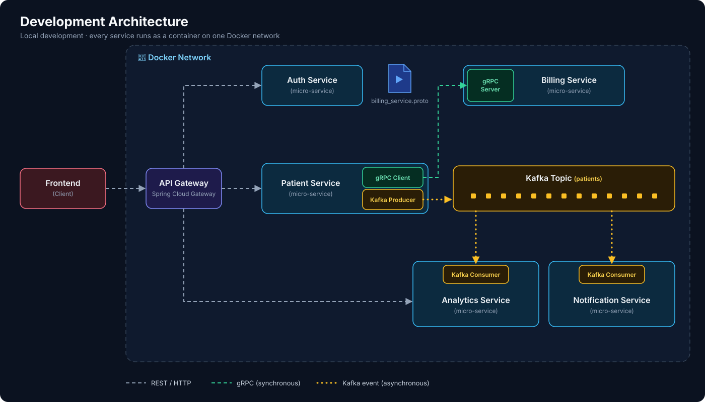
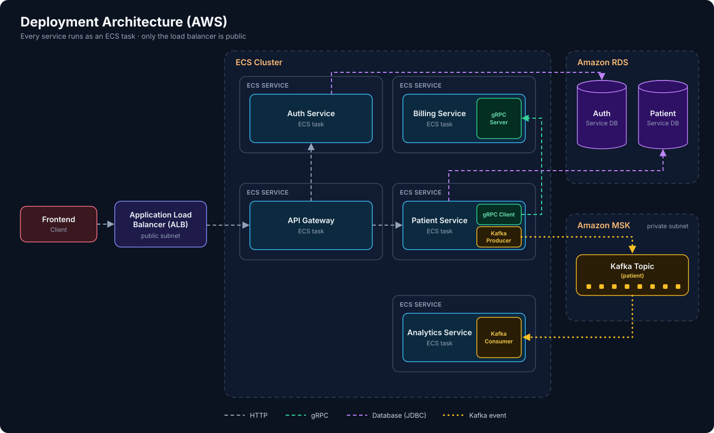
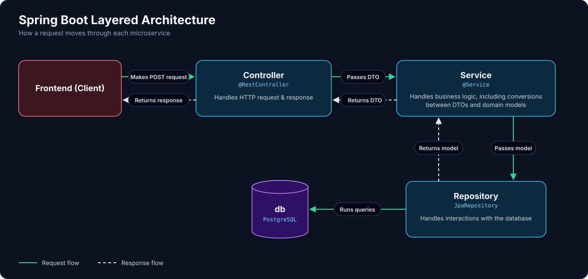

# MediCore

> A cloud-native **Patient Management System** built with Java, Spring Boot, and a microservices architecture — using REST, gRPC, and Kafka for communication, and deployed to AWS with infrastructure as code.


---

## Table of Contents

- [Overview](#overview)
- [Key Features](#key-features)
- [Tech Stack](#tech-stack)
- [Architecture](#architecture)
  - [Development Architecture](#development-architecture)
  - [Deployment Architecture (AWS)](#deployment-architecture-aws)
  - [Service Layered Architecture](#service-layered-architecture)
- [Services](#services)
- [Communication Patterns](#communication-patterns)
- [Project Structure](#project-structure)
- [Getting Started](#getting-started)
- [Configuration](#configuration)
- [Testing](#testing)
- [Deployment](#deployment)
- [API Overview](#api-overview)
- [Roadmap](#roadmap)
- [Contributing](#contributing)
- [License](#license)

---

## Overview

**MediCore** manages patient records, billing accounts, analytics, and notifications for healthcare providers. Each business capability lives in its own independently deployable Spring Boot microservice with its own database, and services talk to each other through the protocol that fits the interaction:

| Interaction | Protocol | Why |
|---|---|---|
| Client → system | **REST (HTTP/JSON)** via API Gateway | Simple, widely supported, easy to secure |
| Service → service (sync) | **gRPC** | Fast, strongly typed contracts via Protocol Buffers |
| Service → service (async) | **Kafka** | Loose coupling; many consumers can react to the same event |

---

## Key Features

- 🧑‍⚕️ **Patient management:** create, read, update, and delete patient records
- 💳 **Billing:** a billing account is created automatically for each new patient (gRPC)
- 📊 **Analytics:** patient events are consumed from Kafka for reporting
- 🔔 **Notifications:** patient events trigger notifications (Kafka consumer)
- 🔐 **Security:** JWT bearer-token authentication, enforced at the API Gateway
- 🚪 **Single entry point:** Spring Cloud Gateway routes and secures all client traffic
- 🧪 **Integration tests:** end-to-end tests against the running stack
- ☁️ **Infrastructure as code:** AWS CDK stack, tested locally with **LocalStack**

---

## Tech Stack

| Layer | Technology |
|---|---|
| Language | Java 21 |
| Framework | Spring Boot 3, Spring Data JPA, Spring Security, Spring Cloud Gateway |
| Database | PostgreSQL (one database per service) |
| Messaging | Apache Kafka (AWS MSK in production) |
| RPC | gRPC + Protocol Buffers |
| Auth | JWT (bearer tokens) |
| API docs | OpenAPI / Swagger (springdoc) |
| Build | Maven |
| Containers | Docker, Docker Compose |
| Cloud | AWS ECS (Fargate), RDS, MSK, ALB, VPC |
| IaC | AWS CDK (Java) |
| Local cloud | LocalStack |
| Testing | JUnit 5, RestAssured |

---

## Architecture

### Development Architecture

In development, every service runs as a Docker container on a shared **Docker network**. The client only ever talks to the API Gateway.



### Deployment Architecture (AWS)

In production, each service runs as an **ECS task** inside an **ECS service** in a single ECS cluster. Only the Application Load Balancer is public; everything else lives in private subnets.



### Service Layered Architecture

Inside each microservice, the code is split into **Controller → Service → Repository** layers. Each layer has one job and talks only to the layer next to it.



| Layer | Package | Responsibility | Works with |
|---|---|---|---|
| **Controller** | `controller` | Maps HTTP endpoints, validates input (`@Valid`), returns status codes | Request and response **DTOs** |
| **Service** | `service` | Business rules; converts DTOs to and from domain models (via `mapper`) | DTOs in and out, **models** to the repository |
| **Repository** | `repository` | Data access through `JpaRepository`; no business logic | JPA **entities (models)** |
| **Model** | `model` | JPA entities that map to database tables | – |
| **DTO** | `dto` | Request and response contracts, kept separate from entities | – |

**Why DTOs?** API contracts stay separate from database entities. Internal fields (such as IDs or audit columns) are never exposed by accident, and the database schema can change without breaking clients.

Typical package layout for a service (for example `patient-service`):

```
src/main/java/com/medicore/patientservice/
├── controller/      # PatientController
├── service/         # PatientService
├── repository/      # PatientRepository
├── model/           # Patient (JPA entity)
├── dto/             # PatientRequestDTO, PatientResponseDTO
├── mapper/          # PatientMapper (DTO ↔ model)
├── exception/       # Custom exceptions + GlobalExceptionHandler
└── PatientServiceApplication.java
```

---

## Services

| Service | Responsibility | Exposes | Data store | Default port* |
|---|---|---|---|---|
| **api-gateway** | Single entry point; routing and JWT validation | REST | – | `4004` |
| **auth-service** | User login, JWT issuing and validation | REST | PostgreSQL (`auth-db`) | `4005` |
| **patient-service** | Patient CRUD; publishes patient events; calls billing | REST, gRPC client, Kafka producer | PostgreSQL (`patient-db`) | `4000` |
| **billing-service** | Creates and manages billing accounts | gRPC server | – | `4001` (HTTP), `9001` (gRPC) |
| **analytics-service** | Consumes patient events for analytics | Kafka consumer | – | `4002` |
| **notification-service** | Sends notifications on patient events | Kafka consumer | – | `4003` |

<sub>* Planned defaults. They may change as services are implemented.</sub>

---

## Communication Patterns

### 1. Synchronous: REST through the API Gateway
1. The client sends `POST /auth/login` and receives a **JWT**.
2. Later requests include the header `Authorization: Bearer <token>`.
3. The gateway checks the token with the auth service, then forwards the request to the target service.

### 2. Synchronous: gRPC (Patient → Billing)
The contract is defined in `billing_service.proto`. When a patient is created, `patient-service` calls `BillingService.CreateBillingAccount` on `billing-service`.

```protobuf
service BillingService {
  rpc CreateBillingAccount (BillingRequest) returns (BillingResponse);
}
```

### 3. Asynchronous: Kafka events
`patient-service` publishes a `PatientEvent` (serialised with Protobuf) to the `patient` topic. `analytics-service` and `notification-service` each consume it independently, in their own consumer groups.

---

## Project Structure

```
MediCore/
├── api-gateway/              # Spring Cloud Gateway
├── auth-service/             # Authentication & JWT
├── patient-service/          # Patient CRUD, gRPC client, Kafka producer
├── billing-service/          # gRPC server
├── analytics-service/        # Kafka consumer
├── notification-service/     # Kafka consumer
├── infrastructure/           # AWS CDK (IaC) + LocalStack scripts
├── integration-tests/        # End-to-end tests (JUnit 5 + RestAssured)
├── docs/images/              # Architecture diagrams (SVG)
├── api-requests/             # .http files for manual API testing
├── grpc-requests/            # .http files for manual gRPC testing
├── docker-compose.yml        # Local development stack
└── README.md
```

---

## Getting Started

### Prerequisites

- **JDK 21**
- **Maven 3.9+** (or the bundled `./mvnw` wrapper)
- **Docker** and **Docker Compose**
- **AWS CLI** and **LocalStack** (for deployment testing only)
- An IDE such as IntelliJ IDEA

### Clone the repository

```bash
git clone https://github.com/tharushika0418/MediCore.git
cd MediCore
```

### Run the full stack locally

```bash
docker compose up --build
```

All client traffic goes through the API Gateway: `http://localhost:4004`.

### Run a single service (for development)

```bash
cd patient-service
./mvnw spring-boot:run
```

---

## Configuration

Each service is configured with environment variables, so no secrets are committed to the repository.

| Variable | Used by | Example |
|---|---|---|
| `SPRING_DATASOURCE_URL` | auth, patient | `jdbc:postgresql://patient-db:5432/db` |
| `SPRING_DATASOURCE_USERNAME` | auth, patient | `admin_user` |
| `SPRING_DATASOURCE_PASSWORD` | auth, patient | *(set locally, never commit)* |
| `SPRING_KAFKA_BOOTSTRAP_SERVERS` | patient, analytics, notification | `kafka:9092` |
| `BILLING_SERVICE_ADDRESS` | patient | `billing-service` |
| `BILLING_SERVICE_GRPC_PORT` | patient | `9001` |
| `JWT_SECRET` | auth | *(base64-encoded secret, never commit)* |
| `AUTH_SERVICE_URL` | api-gateway | `http://auth-service:4005` |

> 💡 Keep local values in a `.env` file. It is listed in `.gitignore`.

---

## Testing

```bash
# Unit tests for a single service
cd patient-service && ./mvnw test

# Integration tests (the stack must be running)
cd integration-tests && ./mvnw test
```

---

## Deployment

The AWS infrastructure (VPC, ECS cluster, RDS, MSK, ALB) is defined as code with **AWS CDK** in `infrastructure/`.

### Local deployment with LocalStack

```bash
# 1. Start LocalStack
localstack start -d

# 2. Synthesise the CloudFormation template
cd infrastructure && ./mvnw compile exec:java

# 3. Deploy the stack to LocalStack
./localstack-deploy.sh
```

The same template can be deployed to a real AWS account after it has been checked on LocalStack.

---

## API Overview

Full interactive docs are served by each service at `/swagger-ui.html` (OpenAPI).

| Method | Endpoint | Description | Auth |
|---|---|---|---|
| `POST` | `/auth/login` | Log in and receive a JWT | ❌ |
| `GET` | `/auth/validate` | Validate a token | ✅ |
| `GET` | `/api/patients` | List all patients | ✅ |
| `POST` | `/api/patients` | Create a patient (triggers billing and Kafka event) | ✅ |
| `PUT` | `/api/patients/{id}` | Update a patient | ✅ |
| `DELETE` | `/api/patients/{id}` | Delete a patient | ✅ |

---

## Roadmap

- [ ] Patient Service: REST CRUD, validation, global exception handling
- [ ] OpenAPI documentation
- [ ] Dockerise services and PostgreSQL
- [ ] Billing Service: gRPC server and `billing_service.proto`
- [ ] Patient Service: gRPC client to Billing
- [ ] Kafka: patient event producer
- [ ] Analytics Service: Kafka consumer
- [ ] Notification Service: Kafka consumer
- [ ] Auth Service: JWT issuing and validation
- [ ] API Gateway: routing and JWT filter
- [ ] Integration tests
- [ ] AWS CDK infrastructure and LocalStack deployment
- [ ] CI pipeline (GitHub Actions)

---

## Contributing

This project follows common industry Git practices.

### Branch naming

```
<type>/<short-kebab-case-description>
```

| Type | Use for | Example |
|---|---|---|
| `feature/` | New functionality | `feature/patient-service-crud` |
| `fix/` | Bug fixes | `fix/patient-email-validation` |
| `docs/` | Documentation only | `docs/add-project-readme` |
| `chore/` | Build, tooling, config | `chore/add-gitignore` |
| `refactor/` | Code changes with no behaviour change | `refactor/billing-grpc-client` |
| `test/` | Adding or updating tests | `test/patient-integration-tests` |
| `ci/` | CI/CD pipelines | `ci/github-actions-build` |

### Commit messages ([Conventional Commits](https://www.conventionalcommits.org/))

```
<type>(<scope>): <short summary>

feat(patient): add create patient endpoint
fix(billing): handle null patient id in gRPC request
docs(readme): add architecture diagrams
```

### Workflow

1. Branch off `main` using the naming convention above.
2. Make small, focused commits.
3. Open a Pull Request into `main`.
4. Merge after review and passing checks (squash merge preferred).

---

## License

This project is licensed under the MIT License. See [LICENSE](LICENSE) for details.
